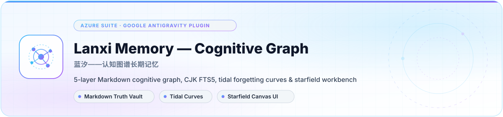
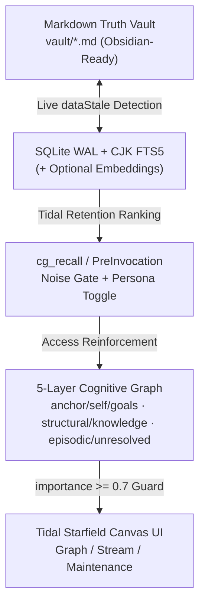

<div align="center">

<p>🌐 &nbsp; <a href="README.md">简体中文</a> &nbsp;·&nbsp; <strong>English</strong></p>

<picture>
  <source media="(prefers-color-scheme: dark)" srcset="assets/readme/hero-en-dark.svg">
  
</picture>

<p>
  [](https://github.com/A16Nights/antigravity-lanxi-memory/releases)
  [](https://github.com/A16Nights/antigravity-lanxi-memory/stargazers)
  
  
  
  [](./LICENSE)
</p>

<p>
  <strong>Local-first 5-layer Markdown truth vault + CJK FTS5 + tidal forgetting curves + interactive Starfield UI with zero dependencies</strong>
</p>

<p>
  <a href="#features">✨ Features</a> &nbsp;·&nbsp; <a href="#architecture">🧩 Architecture</a> &nbsp;·&nbsp; <a href="#installation">🚀 Quick Start</a> &nbsp;·&nbsp; <a href="#mcp-tools">🧰 MCP Tools</a> &nbsp;·&nbsp; <a href="#storage">📂 Storage</a> &nbsp;·&nbsp; <a href="#azure-suite">🌌 Azure Suite</a>
</p>

</div>

**Lanxi Memory** is a local-first long-term memory and cognitive graph plugin for **Google Antigravity**. It blends a human-readable 5-layer Markdown vault with power-law / exponential tidal forgetting curves: core anchors and long-term goals never decay, episodic events ebb naturally unless reinforced by recall, and every archive keeps full Markdown files—**never silently deleting memories**.

<table>
<tr>
<td width="50%" valign="top">
<h4>🏛️ 5-Layer Graph & Hard Protection</h4>
Permanent anchors (<code>anchor</code>/<code>self</code>/<code>goals</code>) stay at <code>retention = 1.0</code>; high-importance nodes (<code>>= 0.7</code>) trigger hard protection against accidental archival or demotion.
</td>
<td width="50%" valign="top">
<h4>🌊 Markdown Truth & CJK FTS5</h4>
Built on <code>node:sqlite</code> WAL with CJK bigram FTS5. Edit <code>vault/*.md</code> directly in VS Code or Obsidian with live <code>dataStale</code> detection and one-click reindexing.
</td>
</tr>
<tr>
<td width="50%" valign="top">
<h4>🌌 Interactive Tidal Starfield UI</h4>
Concentric orbital Canvas graph (anchors → knowledge → episodic) with pan/zoom, edge highlighting, visual linking, and a Tidal Maintenance console.
</td>
<td width="50%" valign="top">
<h4>✨ 100% Offline + Optional AI Boost</h4>
Works completely offline with zero API keys; optionally connect any OpenAI-compatible endpoint for hybrid FTS5 + cosine vector search and AI episodic distillation.
</td>
</tr>
</table>

<h2 id="features">
<picture>
  <source media="(prefers-color-scheme: dark)" srcset="assets/readme/sec-features-en-dark.svg">
  
</picture>
</h2>

### 1. Five-Layer Cognitive Structure & Hard Protection
- **Permanent Anchor Layers (`retention = 1.0`)**:
  - `anchor`: Inviolable global boundaries and cross-project rules;
  - `self`: Long-term collaboration preferences and metacognitive reflections;
  - `goals`: Persistent multi-session milestones and objectives.
- **High-Value Knowledge Layers (`importance >= 0.7` Hard Protection)**:
  - `structural`: Architecture decisions, module boundaries, and engineering contracts;
  - `knowledge`: Reusable technical solutions, debugging findings, and configuration notes;
  - **Anti-Amnesia Hard Protection**: Archiving or demoting nodes with `importance >= 0.7` requires explicit confirmation (`override: true` or in-panel modal); optional `writeGate` prevents unconfirmed auto-locks.
- **Tidal Flow Layers**:
  - `episodic` (**default safe layer**): Follows tidal forgetting curves, rises on access reinforcement, and can be promoted to `knowledge` / `structural` in one click;
  - `unresolved`: Tracks open technical mysteries and pending follow-ups.

### 2. Disk-as-Truth (`dataStale`) & CJK FTS5 Engine
- **Native SQLite WAL + CJK FTS5**: Powered solely by Node.js (`>= 22.0.0`) built-in `node:sqlite` with CJK bigram tokenization, English stemming, and code identifier matching.
- **External Edit Awareness**: Edit `vault/*.md` freely in Obsidian or VS Code; the top bar automatically detects file changes and prompts a one-click index rebuild.

### 3. Smart Lifecycle Hooks & Persona Memory Gate
- **`SessionStart`**: Automatically wakes permanent anchors, active goals, and top project memories.
- **`PreInvocation`**: On-demand recall with `strict / balanced / loose` noise-suppression thresholds, periodic long-session archival reminders, and automatic synchronization with **[Soul.md](https://github.com/A16Nights/antigravity-soul-md)** per-persona memory toggles.

### 4. Tidal Starfield Visual Workbench (Sidecar + Web UI)
- **Balanced Two-Row Header**: Clean title, status badges, and Azure Suite toolbar on row 1; 5 centered workspace tabs on row 2.
- **🌌 Tidal Starfield**: Interactive concentric orbital Canvas graph with drag-pan, wheel-zoom, hover edge highlights, and visual linking.
- **📜 Memory Stream, 🎯 Anchors & Goals, ⚙ Tidal Maintenance**: Filter by layer/project/retention, promote or condense candidates, batch-confirm importance (`set_importance`), and import external Markdown / Obsidian vaults read-only.

### 5. Optional AI Semantic Enhancement (Off by Default)
- Runs 100% locally offline without any API key.
- Optionally configure any OpenAI-compatible endpoint in Maintenance to unlock **Hybrid Vector Search (FTS5 + Cosine Similarity)** and **AI Distillation** (condensing scattered `episodic` notes into dense `knowledge` nodes).

### 6. Unified Azure Suite UI
- **Neko Glass UI & Shared Theme Center**: Light/dark themes, custom glass dropdowns & modals, 6 official presets + custom dual pickers + 4 shared slots, sidebar toggle, fullscreen `Web UI`, and GitHub Release update checks.

<h2 id="architecture">
<picture>
  <source media="(prefers-color-scheme: dark)" srcset="assets/readme/sec-arch-en-dark.svg">
  
</picture>
</h2>



<h2 id="installation">
<picture>
  <source media="(prefers-color-scheme: dark)" srcset="assets/readme/sec-install-en-dark.svg">
  
</picture>
</h2>

> **Prerequisite**: **Node.js >= 22.0.0** (zero third-party npm dependencies, pure native ESM).

### Option 1 · Let Antigravity Install It for You (Recommended)

Copy and send the following prompt directly to Antigravity:

> Please clone `https://github.com/A16Nights/antigravity-lanxi-memory.git` into my Antigravity global plugins directory as `lanxi-memory`, verify the directory structure, and tell me once it is ready so I can press `Ctrl+R` to reload.

### Option 2 · Manual Git Clone

```powershell
# Windows (PowerShell)
git clone https://github.com/A16Nights/antigravity-lanxi-memory.git "$env:USERPROFILE\.gemini\config\plugins\lanxi-memory"

# macOS / Linux
git clone https://github.com/A16Nights/antigravity-lanxi-memory.git ~/.gemini/config/plugins/lanxi-memory
```

Restart or reload Antigravity (`Ctrl+R`), enable **Lanxi Memory** in **Plugins**, and open it from the left sidebar or right-hand panel.

<h2 id="mcp-tools">
<picture>
  <source media="(prefers-color-scheme: dark)" srcset="assets/readme/sec-tools-en-dark.svg">
  
</picture>
</h2>

| Tool | Description |
| --- | --- |
| `cg_write` | Write a memory node (defaults to `episodic`; supports `layer`, `project`, `importance`, `tags`, `links`) |
| `cg_recall` | Tidal-weighted + project-prioritized recall (hybrid FTS5 + vector ranking when embeddings are enabled) |
| `cg_read` | Read full Markdown body, retention score, links, and disk sync state by node ID |
| `cg_update` | Update body, title, layer, tags, or importance (with hard-protection & demotion guards) |
| `cg_forget` | Explicitly archive a node into `vault/archive/` (preserves full files, never hard-deletes) |
| `cg_link` | Create a directed semantic link between two nodes (synced to Markdown frontmatter) |
| `cg_graph` | Fetch the full cognitive graph or a local subgraph around a focal node |
| `cg_goal` | Query, create, or update long-term `goals` milestones |
| `cg_reflect` | Record metacognitive reflections (`self`) or open mysteries (`unresolved`) |
| `cg_maintain` | Run tidal maintenance: candidate queues, promotion, reinforcement, `set_importance`, condense, embeddings, reindex |
| `cg_stats` | Inspect layer counts, retention distribution, `dataStale` status, and masked configuration |
| `cg_import_vault` | Strictly read-only import from external Markdown folders, Obsidian Vaults, or DSH memory stores |

<h2 id="storage">
<picture>
  <source media="(prefers-color-scheme: dark)" srcset="assets/readme/sec-storage-en-dark.svg">
  
</picture>
</h2>

<details open>
<summary><strong>Click to inspect local data paths & shared Azure Suite configs</strong></summary>

<br>

- **Markdown Truth Vault**: `~/.gemini/lanxi-memory/vault/` (also compatible with `~/.gemini/lingshu-cortex/vault/`)
- **Local FTS5 & Vector Index**: `~/.gemini/lanxi-memory/index.sqlite`
- **Plugin & Optional AI Config**: `~/.gemini/lanxi-memory/config.json`
- **Shared Azure Suite Theme & Sidebar Config**: `~/.gemini/azure-theme.json`, `~/.gemini/azure-sidebar-nav.json`

</details>

<h2 id="azure-suite">
<picture>
  <source media="(prefers-color-scheme: dark)" srcset="assets/readme/sec-suite-en-dark.svg">
  
</picture>
</h2>

All **8 Azure Suite plugins** share a unified **Neko Glass UI**, synchronized **Azure Theme Center** (`~/.gemini/azure-theme.json`), and customizable **Sidebar Navigation Hub** (`~/.gemini/azure-sidebar-nav.json`):

| Plugin | Repository | Core Capability |
| --- | --- | --- |
| ✦ **External Orchestrator** | [antigravity-external-orchestrator](https://github.com/A16Nights/antigravity-external-orchestrator) | Multi-provider external worker routing, custom profiles, circuit breaker & live monitoring |
| 🪐 **Azure Orbit** | [antigravity-azure-orbit](https://github.com/A16Nights/antigravity-azure-orbit) | Mount external LLM APIs directly into Antigravity's native bottom-left model selector |
| 🧭 **Azure Compass** | [antigravity-azure-compass](https://github.com/A16Nights/antigravity-azure-compass) | Agent mode presets, live context telemetry with auto /compact & Azure Suite sidebar hub |
| 🏛️ **Azure Corridor** | [antigravity-azure-corridor](https://github.com/A16Nights/antigravity-azure-corridor) | Read-only FTS5 conversation search, custom project groups, priority tags & safe archive |
| 🌌 **Lanxi Memory** &nbsp;`✦ This Repo` | [antigravity-lanxi-memory](https://github.com/A16Nights/antigravity-lanxi-memory) | 5-layer Markdown cognitive graph, CJK FTS5, tidal forgetting curves & starfield UI |
| 💎 **Soul.md Studio** | [antigravity-soul-md](https://github.com/A16Nights/antigravity-soul-md) | Hot-swappable persona cards, workspace binding, external-model anchor & layered memory |
| 💭 **Think-ZH** | [antigravity-think-zh](https://github.com/A16Nights/antigravity-think-zh) | Simplified Chinese / English reasoning switcher with dual-channel anti-drift hooks |
| 🔮 **Azure Prism** | [antigravity-azure-prism](https://github.com/A16Nights/antigravity-azure-prism) | Native MCP App Chain-of-Thought viewer with keyless zero-token MT & LLM translation |

---

### 💡 Acknowledgements

Independently designed and built on the native Antigravity plugin protocol, inspired by:
- [dsh-memory](https://github.com/FuRongJun-1999/dsh-memory) — 5-layer Markdown cognitive vault, hard protection, and deterministic rules
- [CortexGraph](https://github.com/prefrontal-systems/cortexgraph) — Power-law forgetting curves and access reinforcement

---

<div align="center">

📄 Released under the **[MIT License](./LICENSE)** · Crafted for **Google Antigravity**

</div>
