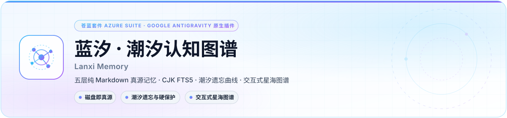
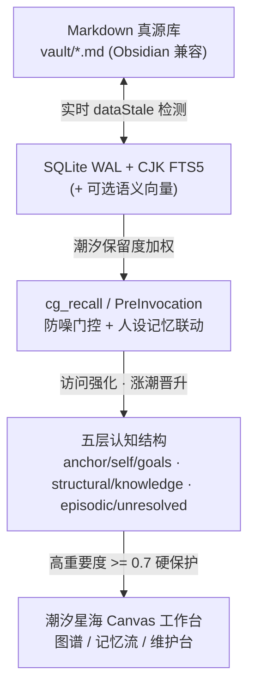

<div align="center">

<p>🌐 &nbsp; <strong>简体中文</strong> &nbsp;·&nbsp; <a href="README.en.md">English</a></p>

<picture>
  <source media="(prefers-color-scheme: dark)" srcset="assets/readme/hero-dark.svg">
  
</picture>

<p>
  <a href="https://github.com/A16Nights/antigravity-lanxi-memory/releases"></a>
  <a href="https://github.com/A16Nights/antigravity-lanxi-memory/stargazers"></a>
  
  
  
  <a href="./LICENSE"></a>
</p>

<p>
  <strong>五层纯 Markdown 真源记忆 + CJK FTS5 + 幂律潮汐遗忘曲线 + 交互式潮汐星海图谱（100% 本地零依赖）</strong>
</p>

<p>
  <a href="#features">✨ 功能全景</a> &nbsp;·&nbsp; <a href="#architecture">🧩 工作原理</a> &nbsp;·&nbsp; <a href="#installation">🚀 快速安装</a> &nbsp;·&nbsp; <a href="#mcp-tools">🧰 MCP 工具</a> &nbsp;·&nbsp; <a href="#storage">📂 数据存储</a> &nbsp;·&nbsp; <a href="#azure-suite">🌌 苍蓝全家桶</a>
</p>

</div>

**蓝汐（Lanxi）** 是一款专为 **Google Antigravity** 打造的纯本地长期记忆与认知图谱插件。它将「人类可读的五层纯 Markdown 真源文档（Vault）」与「幂律 / 指数潮汐遗忘曲线」深度融合：核心架构约定与长期目标永久锚定不衰减，日常情景随时间自然退潮、被频繁检索或强化则涨潮晋升，所有归档均保留完整原文件，**绝不静默丢弃任何记忆**。

<table>
<tr>
<td width="50%" valign="top">
<h4>🏛️ 五层认知结构 & 硬保护防失忆</h4>
定海锚点层（<code>anchor</code>/<code>self</code>/<code>goals</code>）永久保留；高重要度节点（<code>importance >= 0.7</code>）自动硬保护，防止误删与误降级。
</td>
<td width="50%" valign="top">
<h4>🌊 磁盘即真源 & CJK FTS5 检索</h4>
基于 <code>node:sqlite</code> WAL + 中文双字切词 FTS5；支持 Obsidian / VS Code 直接编辑 <code>vault/*.md</code>，顶栏实时感知 <code>dataStale</code> 一键重建索引。
</td>
</tr>
<tr>
<td width="50%" valign="top">
<h4>🌌 交互式「潮汐星海」Canvas 图谱</h4>
同心轨道星图直观展示锚点、知识与情景节点，支持拖拽缩放、悬停高亮关联边、可视化建边与一键潮汐维护台。
</td>
<td width="50%" valign="top">
<h4>✨ 100% 离线可用 + 可选 AI 增强</h4>
零 API Key 即可离线满血运行；接入任意 OpenAI 兼容接口后可选解锁「FTS5 + 语义向量混合检索」与「AI 情景智能凝结」。
</td>
</tr>
</table>

<h2 id="features">
<picture>
  <source media="(prefers-color-scheme: dark)" srcset="assets/readme/sec-features-dark.svg">
  
</picture>
</h2>

### 1. 五层认知结构与防误锁硬保护机制
- **定海锚点层（永久保留 `retention = 1.0`）**：
  - `anchor`（核心锚点）：不可违背的全局底线与跨项目铁律；
  - `self`（自我与偏好认知）：长期协作风格、交互偏好与元认知沉淀；
  - `goals`（长期目标）：跨会话持续追踪的里程碑与待办目标。
- **高价值知识层（支持 `importance >= 0.7` 硬保护）**：
  - `structural`（架构与工程规律）：项目架构决策、模块边界与核心规范；
  - `knowledge`（通用知识与排错经验）：可复用的技术方案、踩坑结论与配置经验；
  - **硬保护防失忆**：重要度 `>= 0.7` 的节点自动触发硬保护，归档或降级必须经面板内毛玻璃确认弹窗（或显式传入 `override: true`）二次确认；支持可选 `writeGate` 写入门控，防止模型自评高重要度未确认前擅自锁死。
- **潮汐流动层**：
  - `episodic`（情景事件，**默认安全落层**）：随手记录或未声明层级的记忆默认进入情景层，遵循潮汐遗忘曲线自然衰减，召回或强化后自动涨潮，并可在维护台一键晋升至 `knowledge` / `structural`；
  - `unresolved`（待解决疑点）：持续追踪尚未闭环的技术疑点与遗留问题。

### 2. 磁盘即真源（`dataStale` 实时感知）与 CJK FTS5 检索引擎
- **纯本地 SQLite WAL + CJK 分词 FTS5**：仅依赖 Node.js（`>= 22.0.0`）内置 `node:sqlite`，对中文双字切词、英文词干与代码标识符进行高速全文索引。
- **外部编辑实时感知**：你可以随时使用 VS Code、Obsidian 或任意文本编辑器直接修改 `vault/*.md`，插件会自动检测磁盘文件增删改并在顶栏提示一键重建索引。

### 3. 智能生命周期 Hook与人设记忆联动
- **`SessionStart`（新会话锚点唤醒，默认开启）**：开场自动加载定海锚点、活跃长期目标与当前项目高权重记忆。
- **`PreInvocation`（每轮前置按需召回 + 长会话归档提醒）**：
  - 支持 `strict / balanced / loose` 三档实词覆盖率防噪门槛，彻底杜绝无关旧记录刷屏；
  - 支持长会话周期性归档提醒，防止重要决策随会话结束遗失；
  - **联动苍蓝魂匣（`soul-md`）人设记忆开关**：当当前生效人设卡关闭记忆功能时，自动静默跳过记忆注入与沉淀。

### 4. 原创「潮汐星海」可视化工作台（Sidecar + 独立 Web UI）
- **两行居中对齐顶栏**：第一行集成标题、状态徽标与苍蓝套件标准工具栏，第二行居中排布五大功能标签页，视觉平衡清爽。
- **🌌 潮汐星海（交互式 Canvas 星图）**：同心轨道潮汐星图（内圈永久锚点 → 中圈结构/知识 → 外圈情景/待决），支持鼠标拖拽平移、滚轮缩放、悬停高亮关联边、点击查看节点详情与可视化建边。
- **📜 记忆流 & 🎯 锚点与目标**：支持按层级、项目（Project）、关键词与保留度筛选，面板内直接新建、编辑、强化、晋升、建边或归档记忆节点。
- **⚙ 潮汐维护台**：潮汐水位分布条、待晋升/待归档候选队列、批量重要度确认（`set_importance`）、手动合并凝结、索引重建及外部 Markdown / Obsidian Vault 只读导入。

### 5. 可选 AI 语义增强（默认关闭，100% 离线可用）
- 不配置任何 API Key 即可 100% 本地离线完整运行；
- 在「潮汐维护 → 可选 AI 增强接口」中接入任意 OpenAI 兼容接口后，可额外解锁 **混合语义向量检索（FTS5 + Cosine Similarity）** 与 **AI 智能凝结（自动将多条零散 `episodic` 情景提炼合成为高密度 `knowledge` 节点）**。

### 6. 外部知识目录增量同步、项目活地图、溯源回滚、断点防重与跨工具 MCP 共享
- **📚 外部知识目录增量同步 FTS5**：支持在维护台绑定本地经验文档或笔记目录（只读），按文件修改时间与哈希自动增量切块同步进 FTS5 索引，绝不修改原文件；对话召回时自动匹配外部知识切片。
- **🗺️ 项目活地图（Project Briefing）**：自动按当前项目聚合架构规范、进行中目标、待解决疑点与核心避坑，在 `SessionStart` 开场注入精炼高密度概览，面板支持实时预览与一键复制。
- **🔗 原话溯源与 `.bak` 自动快照回滚**：自动沉淀记忆时记录 `conversationId#stepIndex` 溯源标记（面板一键复制会话 ID 定位原对话）；`cg_update` 覆写或合并前自动生成 `vault/.backups/*.bak.md` 快照（每节点保留最近 5 份），支持面板或 MCP 一键回滚上一版。
- **🛡️ 2.35.1+ 断点防重 & 单一真源自动去重**：原生支持 Antigravity 2.35.1+ 断点恢复防重；节点归档/换层/重建索引时自动清理跨目录同名旧副本并备份至 `vault/.backups/`，确保磁盘真源与数据库索引严格一致。
- **🔌 跨工具 MCP 一键共享**：面板内直接生成本机标准 `mcpServers` JSON 与 Claude Code CLI 命令，一键复制即可在 Claude Code / Cursor / Codex 等 MCP 客户端中共用同一个蓝汐记忆库。

### 7. 苍蓝统一视觉与交互体系
- **Neko Glass 毛玻璃界面 & 苍蓝主题色调中心**：深色/浅色切换、自定义毛玻璃下拉框（`AzureSelect`）与确认弹窗、6 套官方配色预设 + 自定义双色 + 4 个自定义栏位跨插件同步、左侧栏快捷入口开关、独立浏览器全屏 `Web UI` 与 GitHub Release 在线更新检查。

<h2 id="architecture">
<picture>
  <source media="(prefers-color-scheme: dark)" srcset="assets/readme/sec-arch-dark.svg">
  
</picture>
</h2>



<h2 id="installation">
<picture>
  <source media="(prefers-color-scheme: dark)" srcset="assets/readme/sec-install-dark.svg">
  
</picture>
</h2>

> **前置要求**：**Node.js >= 22.0.0**（零第三方 npm 运行时依赖，纯 Node.js 原生 ESM 实现）。

### 方式一 · 一句话让 Antigravity 帮你自动安装（推荐）

直接把下面这句话发给 Antigravity 即可自动完成克隆与核验：

> 帮我把 `https://github.com/A16Nights/antigravity-lanxi-memory.git` 克隆到本机 Antigravity 全局插件目录，目录名设为 `lanxi-memory`，检查目录无误后告诉我，我再按 `Ctrl+R` 重载生效。

### 方式二 · 命令行手动克隆

```powershell
# Windows (PowerShell)
git clone https://github.com/A16Nights/antigravity-lanxi-memory.git "$env:USERPROFILE\.gemini\config\plugins\lanxi-memory"

# macOS / Linux
git clone https://github.com/A16Nights/antigravity-lanxi-memory.git ~/.gemini/config/plugins/lanxi-memory
```

重启或重载 Antigravity（`Ctrl+R`），在 **Plugins** 页面确认 **蓝汐 · 潮汐认知图谱** 已启用即可从左侧栏或右侧辅助面板打开。

<h2 id="mcp-tools">
<picture>
  <source media="(prefers-color-scheme: dark)" srcset="assets/readme/sec-tools-dark.svg">
  
</picture>
</h2>

| 工具名 | 作用 |
| --- | --- |
| `cg_write` | 写入记忆节点（默认落 `episodic`，支持 `layer`、`project`、`importance`、`tags`、`links`） |
| `cg_recall` | 潮汐保留度加权 + 当前项目优先召回（启用 Embedding 时自动执行 FTS5 + 语义向量混合排序） |
| `cg_read` | 按节点 ID 读取完整 Markdown 正文、潮汐保留度、出入边关系与磁盘同步状态 |
| `cg_update` | 更新节点正文、标题、层级、标签或重要度（带硬保护与防误降层拦截） |
| `cg_forget` | 显式将节点归档移入 `vault/archive/`（保留完整文件，绝不静默物理删除） |
| `cg_link` | 在两个记忆节点之间建立有向语义关联边（自动同步写入 Markdown frontmatter） |
| `cg_graph` | 获取全局认知图谱或指定中心节点的局部关联子图 |
| `cg_goal` | 查询、创建或更新 `goals` 层长期目标与里程碑进度 |
| `cg_reflect` | 记录元认知反思（`self`）或登记待解决疑点（`unresolved`） |
| `cg_maintain` | 执行潮汐维护：候选队列查询、节点晋升、访问强化、批量重要度确认、手动/AI 凝结、向量补全、项目活地图（`briefing`）、快照回滚（`rollback`）、外部源增量同步（`sync_sources`）、索引重建 |
| `cg_stats` | 获取各层级节点统计、潮汐水位分布、`dataStale` 磁盘新鲜度检测与脱敏配置 |
| `cg_import_vault` | 严格只读扫描并导入外部 Markdown 目录 / Obsidian Vault |

<h2 id="storage">
<picture>
  <source media="(prefers-color-scheme: dark)" srcset="assets/readme/sec-storage-dark.svg">
  
</picture>
</h2>

<details open>
<summary><strong>点击展开查看本机数据目录与苍蓝套件共享配置路径</strong></summary>

<br>

- **Markdown 记忆真源库**：`~/.gemini/lanxi-memory/vault/`
- **本地全文与向量索引库**：`~/.gemini/lanxi-memory/index.sqlite`
- **插件与可选 AI 接口配置**：`~/.gemini/lanxi-memory/config.json`
- **苍蓝套件共享主题 / 左侧栏配置**：`~/.gemini/azure-theme.json`、`~/.gemini/azure-sidebar-nav.json`

</details>

<h2 id="azure-suite">
<picture>
  <source media="(prefers-color-scheme: dark)" srcset="assets/readme/sec-suite-dark.svg">
  
</picture>
</h2>

**苍蓝套件（Azure Suite）** 9 款插件共享统一的 **Neko Glass 毛玻璃界面**、跨插件同步的 **苍蓝主题色调中心**（`~/.gemini/azure-theme.json`）以及可自由开关的 **左侧栏快捷入口**（`~/.gemini/azure-sidebar-nav.json`）：

| 插件 | 仓库 | 核心能力 |
| --- | --- | --- |
| ✦ **苍蓝协奏台** | [antigravity-external-orchestrator](https://github.com/A16Nights/antigravity-external-orchestrator) | 多渠道外部模型协同调度、自定义调度角色、容灾断路器与全链路实时监控 |
| 🪐 **苍蓝星轨** | [antigravity-azure-orbit](https://github.com/A16Nights/antigravity-azure-orbit) | 将外部大模型直接挂载进 Antigravity 左下角原生模型下拉菜单担任主脑 |
| 🧭 **苍蓝罗盘** | [antigravity-azure-compass](https://github.com/A16Nights/antigravity-azure-compass) | Agent 工作模式预设中心、上下文水位监测与自动 /compact、苍蓝套件左侧栏总控 |
| 🏛️ **苍蓝回廊** | [antigravity-azure-corridor](https://github.com/A16Nights/antigravity-azure-corridor) | 只读原生会话 FTS5 全文检索、自定义项目分组、优先级标签与独立安全归档箱 |
| 🌌 **蓝汐 · 潮汐认知图谱** &nbsp;`✦ 当前仓库` | [antigravity-lanxi-memory](https://github.com/A16Nights/antigravity-lanxi-memory) | 五层纯 Markdown 真源记忆、CJK FTS5、潮汐遗忘曲线与交互式潮汐星海图谱 |
| 💎 **苍蓝魂匣** | [antigravity-soul-md](https://github.com/A16Nights/antigravity-soul-md) | 多人设卡热切换、工作区专属绑定、外接模型智能防掉线锚点与分层文件记忆 |
| 💭 **思语中文** | [antigravity-think-zh](https://github.com/A16Nights/antigravity-think-zh) | 内部思考语言简体中文 / 英文双档热切换、双通道防漂移与实时注入预览 |
| 🔮 **苍蓝棱镜** | [antigravity-azure-prism](https://github.com/A16Nights/antigravity-azure-prism) | 原生 MCP App 思维链实时观测、免密钥零 Token 机翻与外部模型双通道译文 |
| 🪄 **苍蓝魔杖** | [antigravity-azure-wand](https://github.com/A16Nights/antigravity-azure-wand) | Windows 桌面与网页低打扰操控台、独立输入 15 状态 AI 光标、套装画廊混搭与外部光标导入 |

---

### 💡 灵感致谢

本项目为基于 Antigravity 插件协议独立设计与编写的原生实现，设计理念受以下优秀开源项目启发，特此致谢：
- [dsh-memory（灵枢）](https://github.com/FuRongJun-1999/dsh-memory) —— 五层 Markdown 认知图谱、硬保护防失忆与确定性规则理念
- [CortexGraph](https://github.com/prefrontal-systems/cortexgraph) —— 类人幂律遗忘曲线与访问强化机制

---

<div align="center">

📄 Released under the <a href="./LICENSE"><strong>MIT License</strong></a> · Crafted for <strong>Google Antigravity</strong>

</div>
